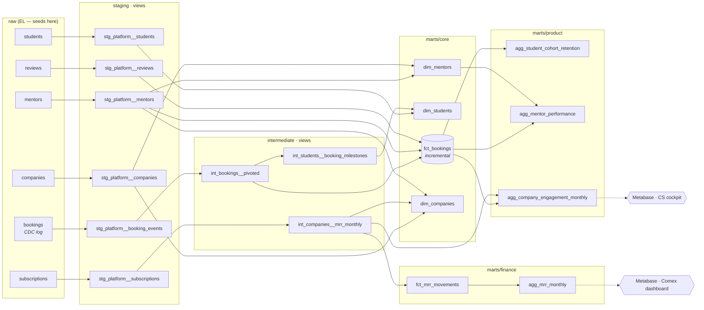

# Mentora Analytics — dbt project


End-to-end analytics engineering project: from a messy production export to
tested, documented marts that answer **growth, product and revenue questions**
for a Comex.

> **Live docs & lineage:** [mateosaguezperso.github.io/mentora-analytics](https://mateosaguezperso.github.io/mentora-analytics/)
>
> **Run it in 2 minutes**, no cloud account needed (DuckDB) — see [Quickstart](#quickstart).

---

## Business context

**Mentora** is a *fictional* B2B2C EdTech marketplace (all data is synthetic,
generated by [`scripts/generate_data.py`](scripts/generate_data.py)):

* **B2B** — companies pay a monthly subscription (employer branding) so that
their employees can act as **mentors**;
* **B2C** — **students** sign up for free and book career-orientation
conversations with those mentors.

The two sides must stay healthy at the same time: if mentors stop answering,
students churn; if students don't book, companies don't see the value and churn.

### Questions the project answers

|#|Business question|Mart|
|-|-|-|
|1|Which acquisition channels bring students who actually **activate** (1st conversation ≤ 30 days)?|`dim_students`|
|2|Do students **come back** after their first conversation?|`agg_student_cohort_retention`|
|3|Which mentors are **unresponsive** and hurt the student experience?|`agg_mentor_performance`|
|4|How does **MRR** move month to month (new, expansion, contraction, churn)? What is our **NRR**?|`fct_mrr_movements`, `agg_mrr_monthly`|
|5|Which customer accounts are **at risk** (paying but not using)?|`agg_company_engagement_monthly`|

---

## Architecture



|Layer|Materialization|Rules|
|-|-|-|
|**staging**|`view`|1:1 with a source. Rename, cast, normalise, dedupe. No joins, no business logic.|
|**intermediate**|`view`|Reusable logic that several marts need (CDC pivot, MRR date spine).|
|**marts**|`table` / `incremental`|One grain per model, documented and tested. What BI tools read.|

---

## Engineering choices worth discussing

**1. Real-world data quality issues, handled where they belong**
The generator injects what you actually meet in production: a **CDC log**
(one row per status change, unordered), inconsistent casing / trailing spaces
(`'Completed'`, `'completed '`), duplicated webhook events, amounts in cents,
messy emails. Everything is fixed **once, in staging**.

**2. Rebuilding state from a CDC log** — [`int_bookings__pivoted`](models/intermediate/int_bookings__pivoted.sql)
Current status via `row_number()`, plus one timestamp per lifecycle milestone
via conditional aggregation. Edge case: two transitions with the **same
timestamp** — ties are broken by lifecycle order so the terminal state wins
(covered by a unit test).

**3. Incremental fact table on mutable data** — [`fct_bookings`](models/marts/core/fct_bookings.sql)
A booking changes status after creation, so `append` would be wrong.
Upsert on `booking_id` with a **3-day lookback window** for late updates.
`merge` + monthly partitioning + clustering on BigQuery, `delete+insert` on DuckDB.

**4. MRR bridge that reconciles to the cent** — [`fct_mrr_movements`](models/marts/finance/fct_mrr_movements.sql)
A company × month **date spine** keeps zero-MRR months after churn, which is
what makes `lag()` able to detect churn and reactivation. A singular test
asserts `opening + new + reactivation + expansion − contraction − churn = closing`
for every month.

**5. Metrics that don't lie**

* Activation excludes **immature cohorts** (`is_activation_window_closed`): students
who signed up 10 days ago haven't had 30 days to activate yet.
* Retention is **exact-month**, on a full cohort × month grid (zeros included,
so the heatmap has no holes).
* Rates use the right denominator (acceptance = accepted / *responded*, not / requested).

**6. Cross-database by design**
All SQL goes through dbt's cross-database macros (`dbt.datediff`, `dbt.dateadd`,
`dbt.date_trunc`, `dbt.split_part`, `dbt.type_*`) plus a custom
[`median()`](macros/median.sql) macro dispatched per adapter
(`APPROX_QUANTILES` on BigQuery, `MEDIAN` on DuckDB). Same code runs in
BigQuery (dev/prod) and DuckDB (local/CI).

**7. Cost & environment safety**
`maximum_bytes_billed` guardrail in the BigQuery profile, environment-aware
[`generate_schema_name`](macros/generate_schema_name.sql) (dev/CI schemas are
prefixed, prod uses clean names), and a frozen `analysis_end_date` var so every
run is reproducible.

---

## Testing strategy

|Type|What it protects|Examples|
|-|-|-|
|**Generic tests** (~90)|Keys, referential integrity, accepted values|`unique`, `not_null`, `relationships`, `accepted_values`|
|**dbt_utils tests**|Business rules across columns|completed ⇒ accepted before; ratings only on completed bookings; ranges 0–1|
|**Custom generic test**|Reusable rule|[`valid_email`](tests/generic/valid_email.sql)|
|**Singular tests**|Cross-model invariants|[MRR bridge reconciles](tests/assert_mrr_bridge_reconciles.sql), [no overlapping subscriptions](tests/assert_no_overlapping_subscriptions.sql)|
|**Unit tests** (dbt ≥ 1.8)|Tricky logic on hand-written fixtures|CDC tie-break, activation window boundary (exactly 30 days), every MRR movement type|
|**Source freshness**|Pipeline is alive|warn if `bookings` not updated for 24 h|

> While building this project, the test *"only completed conversations can be
> rated"* caught a real bug in the data generator (mentors accepting a request
> **after** the conversation date). It was fixed at the source and a
> lifecycle-ordering test was added so it can't regress.

---

## Quickstart

### Option A — local, zero setup (DuckDB)

```bash
git clone https://github.com/mateosaguezperso/mentora-analytics.git
cd mentora-analytics
python -m venv .venv && source .venv/bin/activate
pip install -r requirements.txt

dbt deps
dbt seed                                   # loads raw data (= the EL step)
dbt build --exclude resource_type:seed     # models + data tests + unit tests
dbt docs generate && dbt docs serve        # lineage graph on localhost:8080
```

Regenerate the raw data (deterministic, seed = 42):

```bash
python scripts/generate_data.py
```

### Option B — BigQuery

```bash
pip install dbt-bigquery
gcloud auth application-default login
export DBT_TARGET=bigquery GCP_PROJECT_ID=<your-project> DBT_BQ_DATASET=dbt_<you>
dbt deps && dbt seed && dbt build --exclude resource_type:seed
```

### Useful selectors ([`selectors.yml`](selectors.yml))

```bash
dbt build --selector finance_close      # MRR models + their parents
dbt build --selector comex_dashboard    # everything feeding the Comex exposure
dbt build --selector slim_ci --state ./prod-manifest --defer   # slim CI
```

---

## What the (synthetic) data says

* **Channel quality ≠ volume**: referral and school partnerships activate ~40 %
of students within 30 days, vs ~14 % for paid social → budget should follow activation, not signups.
* **Retention is the real problem**: only ~15 % of students complete another
conversation the month after their first one.
* **Revenue is stable but flat**: NRR hovers around 100 %; expansion roughly
offsets churn.

---

## Project structure

```
├── .github/workflows/      # CI (dbt build on every PR) + docs → GitHub Pages
├── analyses/               # ad-hoc queries (Metabase native questions)
├── docs/                   # doc blocks (docs site homepage)
├── macros/                 # schema naming, cents → euros, cross-db median
├── models/
│   ├── staging/platform/   # 6 models + sources.yml
│   ├── intermediate/       # 3 models
│   └── marts/
│       ├── core/           # fct_bookings, dim_students, dim_mentors, dim_companies
│       ├── product/        # retention, mentor performance, account health
│       ├── finance/        # MRR movements, monthly MRR bridge
│       └── _exposures.yml  # Metabase dashboards
├── scripts/generate_data.py
├── seeds/                  # raw layer (synthetic)
├── tests/                  # singular + custom generic tests
├── dbt_project.yml · packages.yml · profiles.yml · selectors.yml
```

## Roadmap

* [ ] Semantic layer (MetricFlow) for activation rate, MRR and NRR
* [ ] SCD2 snapshot on `subscriptions` (plan history without relying on the source)
* [ ] Model contracts on public marts
* [ ] SQLFluff linting + pre-commit
* [ ] Orchestration (Dagster or Airflow) with daily / monthly schedules

---

*Author: Mateo Saguez —* [*LinkedIn*](https://linkedin.com/in/mateo-saguez)
